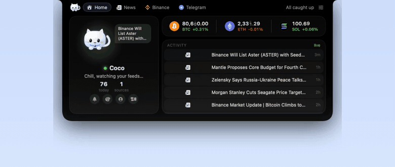
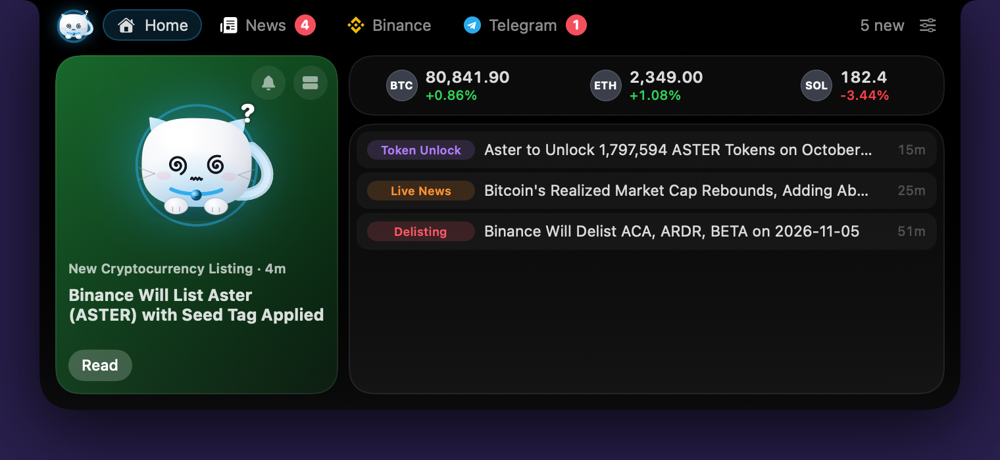
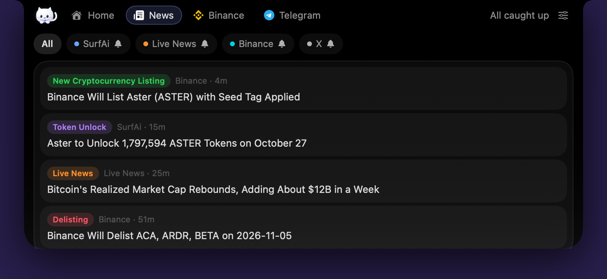
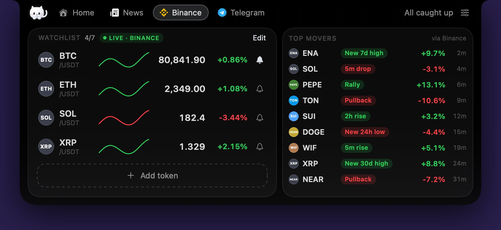
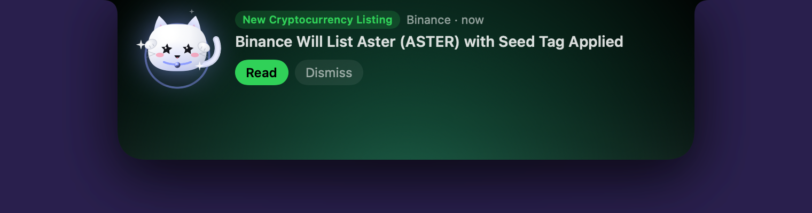

# Coco

**Never miss a headline. Never miss a move.**

A kitten that lives in your Mac's notch and watches crypto news, Binance prices, X and Telegram for you.

---

## Download

1. Download **`CoCo.dmg`** from the [latest release](https://github.com/ClipXonchain/coco-releases/releases/latest).
2. Open it and drag **Coco** to **Applications**.
3. Open Coco from Applications. macOS says **"Coco" Not Opened**: this build isn't notarized by Apple yet, and macOS shows that for any app that isn't. Click **Done**.
4. Open **System Settings › Privacy & Security** and scroll down to **Security**. Next to "Coco" was blocked to protect your Mac, click **Open Anyway**, then confirm with Touch ID or your password. If the button isn't there, open Coco once more and look again.
5. Coco appears in the notch (or at the top of the screen on Macs without one) and in the menu bar.

Right-click › Open no longer works on macOS 15 and later, so Open Anyway is the way. You'll need it again after each update until Coco is notarized.

**Check your download (optional).** `shasum -a 256 ~/Downloads/CoCo.dmg` should print `1213a44bdfaaa6ce25037ab2882b896042545c22798dd22d45b3575d413ed4f6` for v0.1.3 (3,107,913 bytes). If it differs, delete the file and download it again.

Coco appears in the notch (or at the top of the screen on Macs without one) and in the menu bar. Try **Demo events** in the menu bar to see what alerts look like.

Needs an Apple Silicon Mac with macOS 15 or later.

## What it does

| | |
|---|---|
|  |  |
|  |  |

- **News:** SurfAi, Binance Square's Live News, Binance announcements (listings, delistings, airdrops) and X posts from the accounts that matter.
- **Binance prices:** a live watchlist with sparklines, price alerts and Binance's Top Movers. Public market data only, no exchange login.
- **Telegram:** unread chats and new messages, logged in through Coco's own private browser.
- **Alerts your way:** off, badge, ticker, card or card with sound, per source, with quiet hours. The kitten reacts to what happens.

## Updates

Coco checks this page's release feed and tells you in the menu bar when a new version is out. Very old versions may be switched off and asked to update.

## Privacy

Coco runs on your Mac. Prices and news come from public sources; secrets stay in your Keychain; Telegram messages are never written to disk.

## Disclaimer

Coco shows information, not advice. Nothing in it is a recommendation to buy or sell. Binance, X and Telegram are trademarks of their owners; Coco isn't made or endorsed by them.

---

This repository holds Coco's releases only. The source code is private. © 2026 ClipXonchain. All rights reserved.
