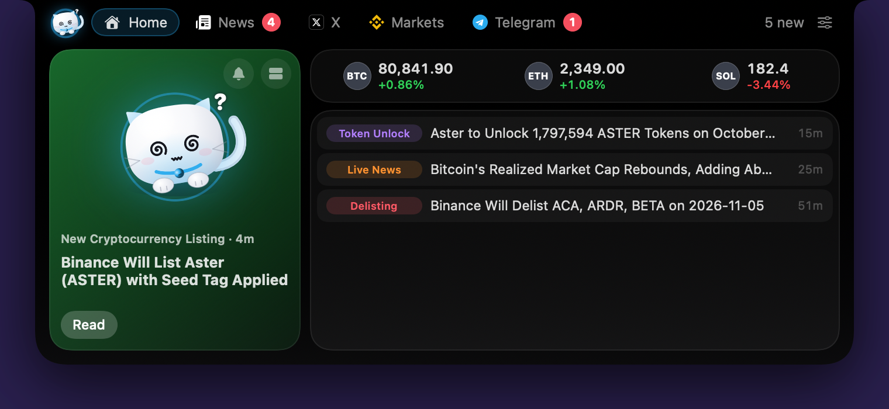
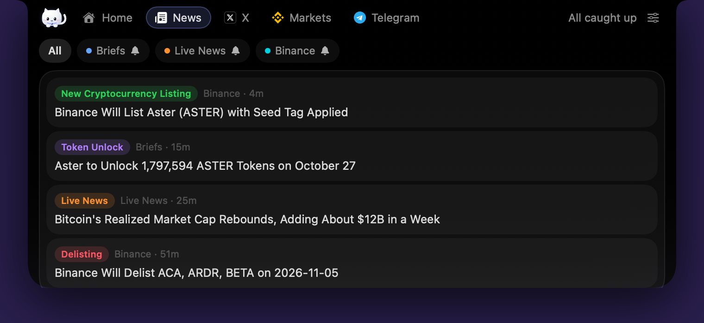
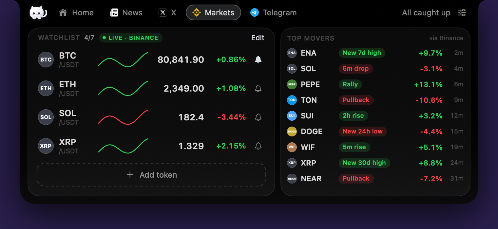
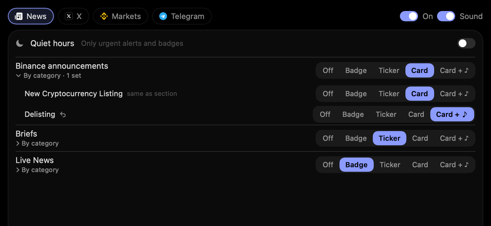

# Coco

**Never miss a headline. Never miss a move.**

A kitten that lives in your Mac's notch (or at the top of your Windows screen) and watches crypto news, prices, X and Telegram for you.

[**Download**](https://github.com/ClipXonchain/coco-releases/releases/latest) · [Website](https://nuviolabs.xyz) · [Changelog](CHANGELOG.md) · [Report a problem](https://github.com/ClipXonchain/coco-releases/issues/new/choose)

---

## Why Coco

Crypto and market news breaks in many places at once: exchange announcements, news feeds, X, Telegram groups. Coco gathers them into one small island at the top of your screen. Each source has its own rule for how loud it may be, and the kitten reacts to what happens: it celebrates a listing, worries about a delisting and naps when you snooze it.

- **Lives in the notch**, or at the top centre on Macs without one and on Windows. It opens when you hover and tucks away when you leave.
- **Alerts you control:** off, badge, ticker, card, or card with sound, for each source and each category, with quiet hours.
- **Calm by default.** No account to make, no ads, no tracking.

## What it does

| | |
|---|---|
|  |  |
| **News.** Briefs, Live News from Binance Square and Binance announcements, tagged by topic. | **Markets.** A live watchlist, price alerts and Top Movers. Public prices only. |
|  |  |
| **Rules.** Pick how loud each source and category is. | **Alerts.** A card with the headline, and the kitten reacting. |

- **📰 News:** *Briefs* (short AI-written news with categories), *Live News* from Binance Square (tagged AI, Stocks, Geopolitics, Markets and more) and *Binance announcements* (listings, delistings, maintenance, airdrops). Read full articles inside Coco, or open the original in one click.
- **𝕏 X:** three views. **Following** has the posts of the accounts you follow, with alerts. **X Feed** is a live feed of every post from the ~150 accounts Binance's Social tracker covers, with each account's picture and the post's image. **List** shows those accounts, searchable and grouped (Crypto, Security): follow one for alerts, and remove or restore any of the built-in accounts.
- **📈 Markets:** a watchlist of up to 7 coins with live prices and sparklines, price alerts (tap the bell on a coin), alerts when a watched coin moves fast, and Top Movers (new highs and lows, rallies, pullbacks). No exchange login, ever.
- **👛 Wallet:** watch up to three EVM or Solana addresses (addresses only, never keys), with totals, top holdings and alerts when tokens arrive, leave or get swapped.
- **💬 Telegram:** unread chats, new messages as alerts, and quick replies. Mac only for now.
- **🔔 Alerts:** five levels per source and per category, quiet hours, a one-hour snooze and several alert sound sets.
- **🐱 The kitten:** 15 moods that follow what is happening, with eyes that follow your pointer. Three themes (Midnight, Aurora, Graphite) and two Home layouts.
- **Open at login** from Settings.

## Install on Mac

1. Download **`CoCo.dmg`** from the [latest release](https://github.com/ClipXonchain/coco-releases/releases/latest).
2. Open it and drag **Coco** onto **Applications**. Then eject the disk and open Coco **from Applications** (not from the disk image).
3. macOS says **"Coco" Not Opened**: this build isn't notarized by Apple yet, and macOS shows that for any app that isn't. Click **Done**.
4. Open **System Settings › Privacy & Security** and scroll to **Security**. Next to "Coco was blocked to protect your Mac", click **Open Anyway** and confirm with Touch ID or your password. If the button isn't there, open Coco once more and look again.
5. Coco appears in the notch and in the menu bar. Try **Demo events** in the menu bar to see what alerts look like.

Needs an Apple Silicon Mac with macOS 15 or later. Right-click › Open no longer works on macOS 15, so Open Anyway is the way. Updating from inside Coco (see Updates) doesn't need it again; a copy you download by hand does, until Coco is notarized.

**Check your download (optional).** Each release lists its SHA-256 checksum in its notes. Run `shasum -a 256 ~/Downloads/CoCo.dmg` and compare. If it differs, delete the file and download it again.

## Install on Windows

1. Download **`CoCo-<version>.exe`** from the [latest release](https://github.com/ClipXonchain/coco-releases/releases/latest). It's one portable file: there's no installer.
2. Put it somewhere you'll keep it (your Desktop or a Coco folder) and double-click it.
3. Windows says **Windows protected your PC**: the app isn't signed yet, and SmartScreen shows that for any app it doesn't recognise. Click **More info**, check the name reads `CoCo-<version>.exe`, then **Run anyway**.
4. Coco appears at the top of your screen and in the system tray. Turn on **Settings › General › Startup › Open Coco at login** if you want it after a restart.

Needs Windows 10 or 11 (64-bit). The Windows app has everything the Mac one has except Telegram. To check the download, run `Get-FileHash $HOME\Downloads\CoCo-<version>.exe` in PowerShell and compare it with the release notes.

## Free and Premium

| | Free | Premium |
|---|---|---|
| News: Briefs, Live News, Binance announcements | ✓ | ✓ |
| Markets: watchlist and Top Movers | ✓ | ✓ |
| Badge and ticker alerts | ✓ | ✓ |
| Card and sound alerts | | ✓ |
| X: Following, X Feed and List | | ✓ |
| Follow any number of accounts from the List | | ✓ (trial: up to 2) |

**Every Mac and PC gets a 3-day trial of Premium** when Coco first runs. After that Coco keeps working as Free (card and sound alerts arrive as tickers) until you activate a Premium key in **Settings › General**. Paid Premium isn't open yet.

## Updates

Coco tells you when a new version is out: in the menu bar (tray on Windows), and in **Settings › General** and **About**, where **Check for Updates** asks right away.

From **0.2.1** on, click **Update Now**. Coco downloads the new version, checks it against a checksum from its server, installs it and restarts by itself, with nothing to download or drag. If it can't (for example Coco isn't in Applications), it opens the download page instead.

Coco 0.2.0 and older can't do this yet: install 0.2.1 or later by hand once, from the [releases page](https://github.com/ClipXonchain/coco-releases/releases/latest). Old versions can be switched off and asked to update, so keep Coco up to date. What changed is in the [changelog](CHANGELOG.md).

## Questions

**I can't find Coco in Applications.** You probably opened it straight from the disk image. Quit it, drag **Coco** onto **Applications** in the disk image window, eject the disk, and open it from Applications.

**Will it open when I start my Mac?** Yes, once you turn on **Settings › General › Startup › Open Coco at login**. Coco has to be in Applications for this to work.

**Does it work on an Intel Mac?** Not yet. This build is for Apple Silicon.

**Is there a Windows version?** Yes: `CoCo-<version>.exe` on the same releases page, for Windows 10 and 11 (64-bit). It has no Telegram yet.

**Update Now asks for nothing but doesn't work.** Coco has to be in Applications (Mac) or running from a folder you can write to (Windows). Otherwise it opens the download page; install that one by hand.

**Lost your Premium key?** Settings › General › Premium › **Lost your key?** opens a message to bnbcaptain on X.

**Is it made by Binance, X or Telegram?** No. Coco is independent and isn't made or endorsed by any of them.

**Something looks wrong.** [Open an issue](https://github.com/ClipXonchain/coco-releases/issues/new/choose) with your Coco and macOS versions and what you saw.

## Privacy

- Coco has no ads and no analytics.
- It asks Coco's server for the news and for your plan. For that it sends an anonymous device ID (a one-way code, not your Mac's hardware ID), the app version and any X accounts you add yourself. If you activate a Premium key, it sends the key.
- Your Telegram login stays in Coco's own private browser on your Mac. Passwords and codes you type go straight to Telegram's page, and Telegram messages are never saved to disk.
- Coco never asks for an exchange login or keys. Markets uses public prices.

Full text: [Privacy](https://nuviolabs.xyz/privacy) · [Terms](https://nuviolabs.xyz/terms).

## Disclaimer

Coco shows information, not advice. Nothing in it is a recommendation to buy or sell. Some sources are web pages, not official services, and can change or stop without notice. Binance, X, Telegram and the coins shown are trademarks of their owners.

## License

Coco is free to download. All rights reserved: the app's source code isn't published. See [LICENSE](LICENSE).
